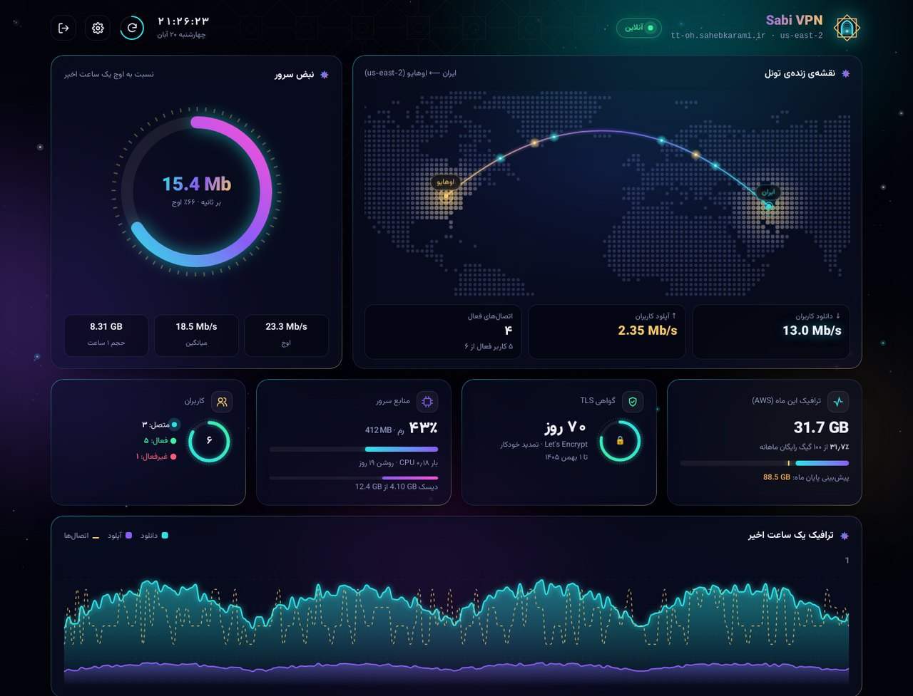
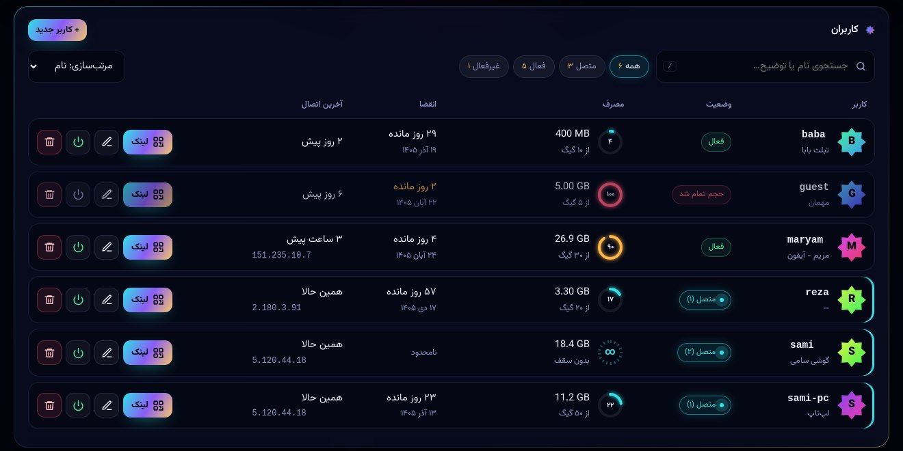
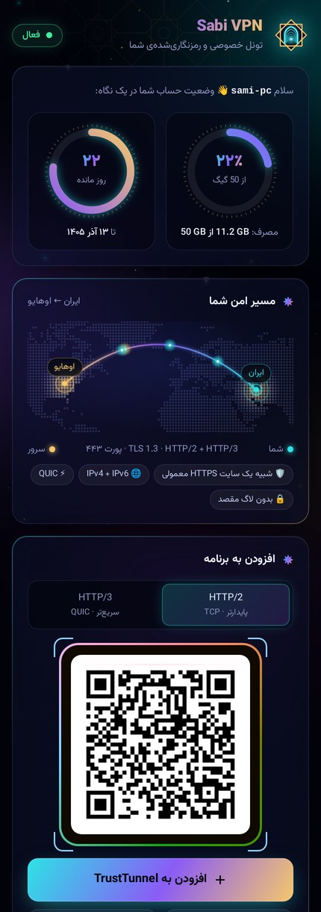
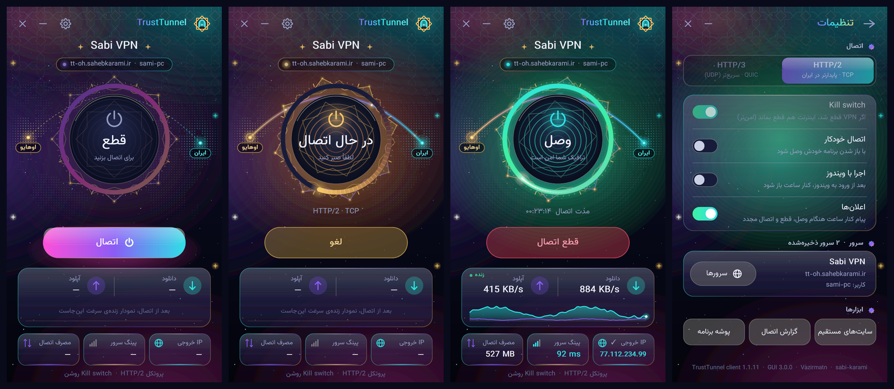
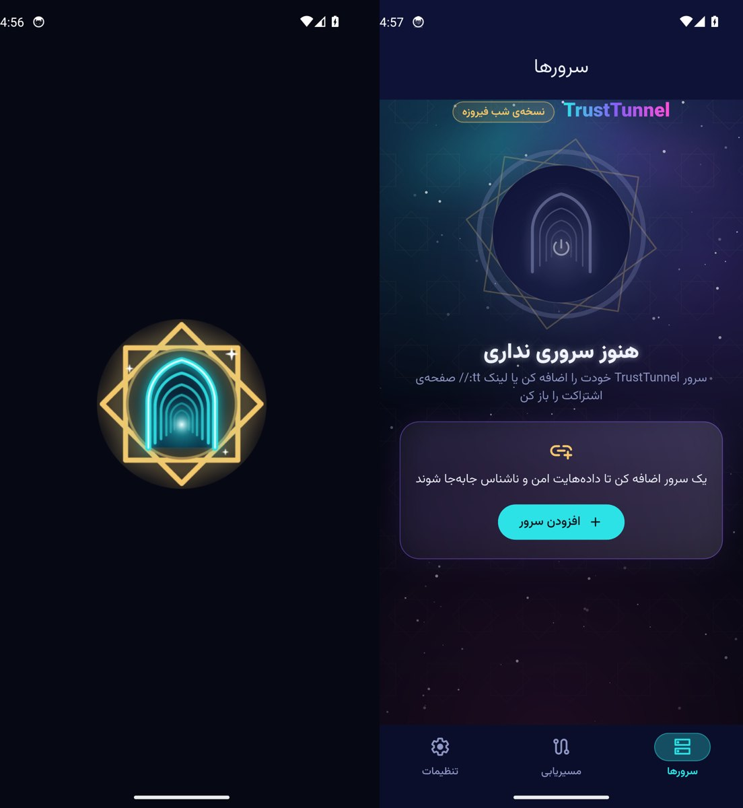
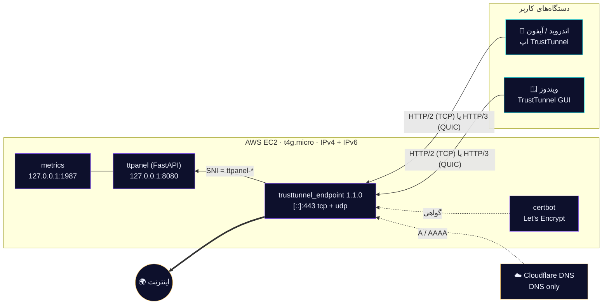

<div align="center">


<br>


<a href="../../actions/workflows/windows-app.yml"></a>

</div>

<div dir="rtl">

سرور شخصی VPN بر پایه‌ی پروتکل متن‌باز [TrustTunnel](https://github.com/TrustTunnel/TrustTunnel) (ساخت AdGuard) به همراه **پنل مدیریت وب فارسی**، **صفحه‌ی اشتراک برای هر کاربر** و **برنامه‌های ویندوز و اندروید** با یک نشان و یک طراحی؛ با یک دستور روی AWS EC2 و Cloudflare DNS. ترافیک از بیرون دقیقاً شبیه یک سایت HTTPS معمولی است.

#### SABI TUNNEL: سرورهای پیش‌فرض و به‌روزرسانی خودکار

- هر کاربر فعال پنل که گزینه‌ی «در برنامه‌ها» برایش روشن است (به‌علاوه‌ی لینک‌های tt:// که مدیر اضافه می‌کند) سرور پیش‌فرض همه‌ی برنامه‌هاست و با فید `/app/v1/feed` خودکار همگام می‌شود.
- با هر push به main، GitHub Actions برنامه‌ها را می‌سازد و از راه `sabi-deploy` روی سرور منتشر می‌کند؛ برنامه‌ها خودشان به‌روز می‌شوند. تغییرات `panel/` هم خودکار روی سرور مستقر می‌شود.
- نام workflowها را عوض نکنید؛ شماره‌ی اجرا (run_number) شماره‌ی ساخت برنامه است.

#### نمای پنل مدیریت



<table>
<tr>
<td width="62%" valign="top"><br><sub>مدیریت کاربران: سهمیه، انقضا، حلقه‌ی مصرف، جست‌وجو و فیلتر</sub></td>
<td width="38%" valign="top"><br><sub>صفحه‌ی اشتراک هر کاربر: QR، دانلود، راهنما</sub></td>
</tr>
</table>

#### برنامه‌ی ویندوز



#### برنامه‌ی اندروید



## معماری



- پنل هم روی همان پورت 443 و با SNI جدا سرو می‌شود (پورت اضافه‌ای باز نیست).
- دو پشته‌ی کامل: سرور هم با IPv4 و هم با IPv6 در دسترس است و ترافیک خروجی کاربران هم روی هر دو کار می‌کند.
- تنظیمات کرنل: BBR + fq، بافرهای بزرگ UDP برای QUIC، swap یک گیگ.

## امکانات پنل

- طراحی «شب فیروزه»: نقش گره و رنگ‌های فیروزه‌ای و طلایی، شفق نئونی، آسمان پرستاره و **نقشه‌ی زنده‌ی تونل** از ایران تا منطقه‌ی سرور
- نبض سرور (سرعت لحظه‌ای نسبت به اوج یک ساعت اخیر)، پیش‌بینی مصرف تا آخر ماه، حلقه‌ی گواهی TLS و منابع سرور
- ساعت و تاریخ شمسی زنده، شمارش معکوس به‌روزرسانی، میان‌بر `/` برای جست‌وجو
- **صفحه‌ی اشتراک هر کاربر** با QR، دکمه‌ی «افزودن به TrustTunnel»، راهنمای قدم‌به‌قدم و **دانلود مستقیم برنامه‌ها از خود سرور** (APK اندروید و نصب‌کننده‌ی ویندوز)؛ گزینه‌ی مناسب دستگاه خودکار بالا می‌آید
- یک نشان در همه‌جا: خاتم طلایی و طاق فیروزه‌ای، در پنل، صفحه‌ی اشتراک، برنامه‌ی ویندوز و اندروید

- ورود امن (PBKDF2، کوکی HttpOnly/Secure/SameSite، محدودیت تلاش ناموفق)
- افزودن / ویرایش / غیرفعال‌سازی / حذف کاربر، تولید مجدد رمز
- **سهمیه حجم** (گیگابایت) و **تاریخ انقضا**؛ کاربر خودکار غیرفعال می‌شود
- لینک `tt://` و **QR کد** هر کاربر، با انتخاب HTTP/2 یا HTTP/3 و آدرس IPv4/IPv6/هر دو/دامنه
- نمودار زنده‌ی ترافیک، نشست‌های فعال، آخرین IP، مصرف تجمعی هر کاربر
- برآورد مصرف ماهانه نسبت به ۱۰۰ گیگ ترافیک رایگان AWS، وضعیت CPU/RAM/دیسک، تاریخ انقضای گواهی

## نصب با یک دستور

پیش‌نیاز روی سیستم خودتان: `python3`، `ssh`، دسترسی AWS (`AWS_PROFILE` یا کلیدها) و یک توکن Cloudflare با دسترسی `Zone → DNS → Edit`.

```bash
git clone https://github.com/sabi-karami/trusttunnel-stack && cd trusttunnel-stack
export CF_API_TOKEN=...      # توکن Cloudflare
./deploy.sh --region us-east-2 --code oh --zone sahebkarami.ir --server-name "Sabi VPN" --first-user sami
```

خروجی: آدرس پنل `https://ttpanel-oh.<zone>` و لینک کاربر اول. رمز ادمین در سرور در فایل `/root/ttpanel-admin.txt` است.

اجرای دوباره‌ی همین دستور امن است (idempotent): منابع با تگ `Project=trusttunnel-stack` پیدا و دوباره استفاده می‌شوند و فقط کانفیگ/نرم‌افزار به‌روز می‌شود.

### نصب روی یک سرور موجود (بدون AWS)

```bash
sudo TT_HOST=tt.example.com PANEL_HOST=panel.example.com FIRST_USER=me ./server/install.sh
```

رکوردهای DNS باید از قبل به IP سرور اشاره کنند و پورت‌های 80/tcp و 443/tcp+udp باز باشند.

## افزودن منطقه‌ی دوم (Multi-region)

هر منطقه یک سرور مستقل با پنل خودش است:

```bash
./deploy.sh --region eu-central-1 --code fra --zone sahebkarami.ir --server-name "Sabi FRA"
```

پیشنهاد برای کاربران ایران: `eu-central-1` (فرانکفورت) یا `eu-south-1` (میلان) معمولاً پینگ کمتری از `us-east-2` دارند.

## هزینه (تقریبی، هر سرور)

| مورد | ماهانه |
|---|---|
| t4g.micro (on-demand) | ~ ۶٫۱ دلار |
| Elastic IPv4 عمومی | ~ ۳٫۶ دلار |
| دیسک gp3 ‏۱۲ گیگ | ~ ۱ دلار |
| ترافیک خروجی | ۱۰۰ گیگ اول رایگان، سپس ~ ۰٫۰۹ دلار/گیگ |
| **جمع** | **~ ۱۰٫۴ دلار** |

CPU credits روی حالت `standard` است تا هزینه‌ی پنهان «unlimited» نداشته باشید. پنل مصرف ماه را نشان می‌دهد.

## نکات مهم

- رکوردهای DNS باید **DNS only (ابر خاکستری)** باشند؛ پراکسی Cloudflare تونل CONNECT را عبور نمی‌دهد.
- نسخه‌ی endpoint روی `1.1.0` پین شده و لینک‌ها با فرمت deep-link نسخه‌ی ۱ ساخته می‌شوند تا با اپ پایدار موبایل سازگار باشند. برای ارتقا: `TT_VERSION=...` در نصب.
- reverse proxy نسخه‌ی 1.1 بدنه‌ی درخواست POST را عبور نمی‌دهد؛ برای همین UI پنل JSON را در هدر `X-Body` (base64) می‌فرستد.
- چون endpoint رمزها را hot-reload نمی‌کند، با تغییر کاربران سرویس چند ثانیه ری‌استارت می‌شود (اتصال‌ها خودکار وصل می‌شوند).
- SSH (پورت 22) باز است و فقط با کلید کار می‌کند؛ اگر لازم نیست در Security Group ببندید.
- بازیابی رمز ادمین: `cd /opt/ttpanel && sudo ./venv/bin/python app.py reset-admin`
- لینک یک کاربر از ترمینال: `sudo ./venv/bin/python app.py link <user>`

## ساختار مخزن

```
deploy.sh               نصب یک‌دستوری (AWS + Cloudflare + SSH)
infra/aws_deploy.py     VPC دو پشته، SG، کلید، EC2، Elastic IP (boto3)
infra/cloudflare_dns.py رکوردهای A/AAAA بدون پراکسی
server/install.sh       نصب‌کننده‌ی سرور (endpoint، گواهی، پنل، systemd)
panel/app.py            بک‌اند پنل (FastAPI) + CLI
panel/index.html        رابط کاربری فارسی
panel/deeplink.py       سازنده‌ی لینک tt:// نسخه ۱
panel/share.html        صفحه‌ی اشتراک کاربر (QR، لینک، دانلود برنامه، راهنما)
panel/assets/           فونت Vazirmatn (woff2) و آیکون‌های سایت، بدون CDN
docs/                   بنر متحرک و تصاویر README
windows-gui/            برنامه‌ی گرافیکی ویندوز (C# WinForms) + نصب‌کننده‌ی Inno Setup
android-app/            برنامه‌ی اندروید «شب فیروزه» (Flutter، بر پایه‌ی کلاینت رسمی ۱٫۲٫۰)
.github/workflows/      ساخت، تست و انتشار برنامه‌های ویندوز و اندروید، اسکن Defender، تصویر رابط کاربری
```

## برنامه‌ی ویندوز (TrustTunnel GUI)

یک برنامه‌ی گرافیکی فارسی برای ویندوز ۱۰/۱۱ که روی کلاینت رسمی TrustTunnel (`trusttunnel_client.exe` + `wintun.dll`) ساخته شده است. کد آن در پوشه‌ی `windows-gui/` است.

**دانلود (نسخه‌ی ۳٫۰٫۲):** از Release با برچسب [`v3.0.2`](../../releases/tag/v3.0.2) همین مخزن. صفحه‌ی اشتراک پنل هم نسخه‌ای را که روی سرور گذاشته شده می‌دهد.

- `TrustTunnel-Setup.exe`: نصب‌کننده (پیشنهادی)؛ میانبر، ثبت لینک‌های `tt://` و حذف از Settings ← Apps
- `TrustTunnel-Windows-GUI.zip`: نسخه‌ی پرتابل بدون نصب

**امکانات**

- نشان تازه، همان آیکون اندروید؛ آیکون کنار ساعت با رنگ وضعیت (فیروزه‌ای: وصل، طلایی: در حال اتصال، کم‌رنگ: قطع)
- طراحی تازه‌ی «شب فیروزه» (نسخه‌ی ۳): شمسه‌ی هشت‌پر چرخان دور دکمه‌ی اتصال، حلقه‌ی نئون، آسمان شفق با نقش گره و ستاره‌ها، نقشه‌ی نقطه‌ای جهان با مسیر زنده‌ی تونل از ایران تا سرور
- دکمه‌ی بزرگ اتصال/قطع با انیمیشن وضعیت، زمان اتصال و نمایش IP خروجی
- انتخاب HTTP/2 یا HTTP/3، نمودار زنده‌ی سرعت دانلود/آپلود
- ذخیره‌ی چند سرور و جابه‌جایی سریع بین آن‌ها
- باز کردن مستقیم لینک‌های `tt://` (دکمه‌ی «افزودن به TrustTunnel» در صفحه‌ی اشتراک پنل)
- Kill switch، اتصال خودکار، اجرا با روشن شدن ویندوز، اعلان‌ها
- «سایت‌های مستقیم»: سایت‌های ایرانی بدون عبور از VPN باز می‌شوند
- آیکون کنار ساعت و ماندن در پس‌زمینه، فونت Vazirmatn داخل برنامه

**ساخت و تست خودکار (CI)**

- `.github/workflows/windows-app.yml`: با هر تغییر در `windows-gui/` برنامه و نصب‌کننده را روی Windows می‌سازد (اجرای دستی با گزینه‌ی `release` آن را در Release منتشر می‌کند)، از همه‌ی حالت‌های رابط کاربری تصویر می‌گیرد (`TrustTunnel.exe --shots=DIR`) و در صورت وجود secretهای تست، نصب، اتصال/قطع، HTTP/3، لینک `tt://`، جابه‌جایی سرور و حذف را روی سرور واقعی تست می‌کند.
- `.github/workflows/ui-shots.yml`: از پنل، صفحه‌ی اشتراک و بنر بالای همین صفحه با داده‌ی نمونه تصویر می‌گیرد.
- `.github/workflows/defender-scan.yml`: همه‌ی فایل‌های خروجی را با Microsoft Defender به‌روز اسکن می‌کند؛ اگر چیزی شناسایی شود بیلد رد می‌شود.

**نکته‌ها**

- فایل‌ها امضای دیجیتال ندارند؛ اگر SmartScreen هشدار داد: More info ← Run anyway.
- از نسخه‌ی ۲٫۱٫۱ برنامه هرگز خودش کلیپ‌بورد را نمی‌خواند (برای چسباندن لینک دکمه‌ی «چسباندن» یا Ctrl+V). نسخه‌های ۲٫۰ و ۲٫۱ به همین دلیل به اشتباه با نام `PWS:MSIL/ClipSteal.YA!MTB` شناسایی می‌شدند؛ آن نسخه‌ها را حذف کنید.
- برنامه برای ساخت کارت شبکه‌ی مجازی دسترسی Administrator لازم دارد.

## برنامه‌ی اندروید (TrustTunnel · شب فیروزه)

نسخه‌ی فارسی و بازطراحی‌شده‌ی [کلاینت رسمی TrustTunnel](https://github.com/TrustTunnel/TrustTunnelFlutterClient) (ساخت AdGuard، مجوز Apache-2.0) بر پایه‌ی **آخرین نسخه‌ی سازنده، ۱٫۲٫۰**. کد آن در پوشه‌ی `android-app/` است و هسته‌ی VPN همان کتابخانه‌ی رسمی TrustTunnel است.

**دانلود:** از صفحه‌ی اشتراک هر کاربر در پنل (فایل‌ها از خود سرور دانلود می‌شوند)، یا از Release با برچسب [`android-v1.2.0`](../../releases/tag/android-v1.2.0).

- `TrustTunnel-Firuze-1.2.0-arm64-v8a.apk`: برای بیشتر گوشی‌های امروزی (پیشنهادی)
- `TrustTunnel-Firuze-1.2.0-armeabi-v7a.apk`: گوشی‌های قدیمی ۳۲بیتی
- `TrustTunnel-Firuze-1.2.0-universal.apk`: اگر مطمئن نیستید، این روی همه کار می‌کند
- `TrustTunnel-Firuze-1.2.0-x86_64.apk`: شبیه‌ساز و Chromebook

نیازمندی: Android 8.0 به بالا. شناسه‌ی بسته `com.sabi.trusttunnel` است، پس کنار برنامه‌ی رسمی هم نصب می‌شود.

**طراحی «شب فیروزه»**

- آسمان شب زنده با شفق، ستاره‌های چشمک‌زن و نقش گره‌ی طلایی پشت همه‌ی صفحه‌ها
- دکمه‌ی اتصال به شکل **دروازه‌ی تونل** با طاق‌های تودرتوی ایرانی؛ حلقه‌ی چرخان هنگام اتصال، تپش نور فیروزه‌ای وقتی وصل است، و لرزش کوتاه (haptic)
- مسیر متحرک «دستگاه شما ← سرور» با پروتکل، IP و نشان رمزنگاری، و زمان اتصال با رقم‌های فارسی
- کارت‌های شیشه‌ای مات، رنگ‌های فیروزه‌ای و طلایی، تم تیره‌ی کامل
- کل رابط به **فارسی و راست‌به‌چپ** با فونت Vazirmatn داخل برنامه
- آیکون تازه (شمسه‌ی هشت‌پر طلایی و طاق فیروزه‌ای) با نسخه‌ی تک‌رنگ برای Android 13، و صفحه‌ی آغاز هماهنگ
- باز کردن مستقیم لینک‌های `tt://` (دکمه‌ی «افزودن به TrustTunnel» در صفحه‌ی اشتراک پنل)

**ساخت خودکار (CI):** `.github/workflows/android-app.yml` با هر تغییر در `android-app/` برنامه را با Flutter 3.38 روی GitHub Actions می‌سازد و APKهای امضاشده را به‌صورت Artifact می‌گذارد؛ اجرای دستی با گزینه‌ی `release` آن‌ها را در Release منتشر می‌کند. کلید امضا در secretهای مخزن (`ANDROID_KEYSTORE_B64`، `ANDROID_KEYSTORE_PASSWORD`، `ANDROID_KEY_ALIAS`) است؛ **همین کلید را نگه دارید**، وگرنه نسخه‌های بعدی روی نسخه‌ی نصب‌شده به‌روز نمی‌شوند.

## حذف کامل

از کنسول AWS منابع با تگ `Project=trusttunnel-stack` (Instance، Elastic IP، VPC، Key pair) را حذف کنید و رکوردهای DNS با کامنت `trusttunnel-stack` را از Cloudflare پاک کنید. **Elastic IP رها‌شده هزینه دارد.**

</div>
